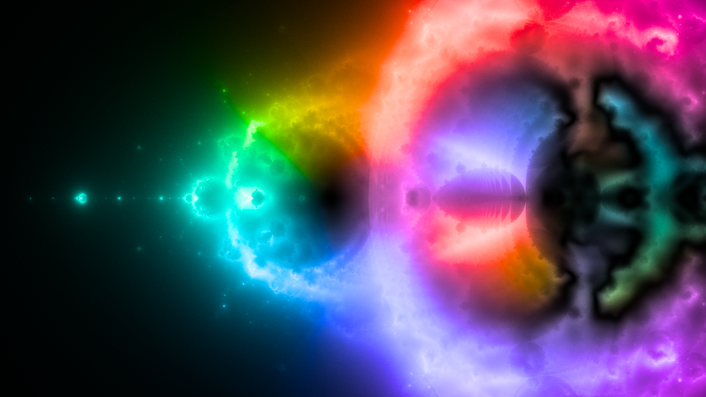
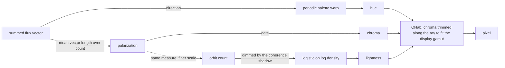
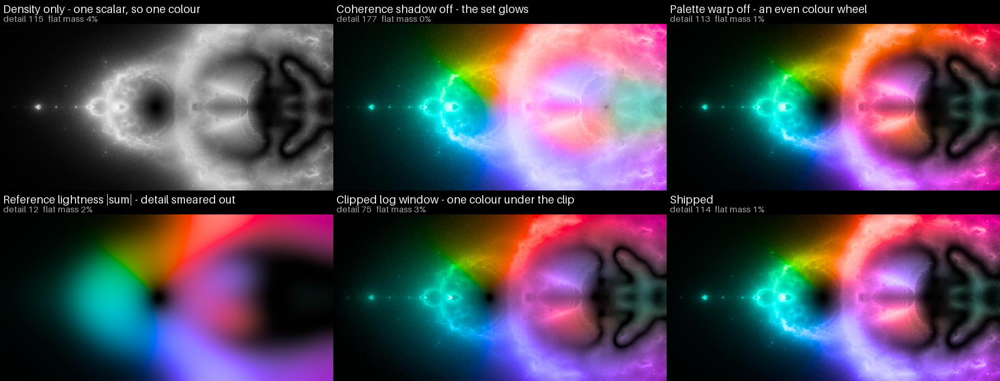

# nebulabrot

A renderer for the **Nebulabrot**: instead of asking whether a Mandelbrot orbit escapes, plot the orbit itself. Every pixel of the frame is a seed `c`, its orbit `z <- z^2 + c` is iterated, and each `z` deposits light into whichever pixel of the *same* frame it lands on. Dense, slow-moving orbits build nebula clouds; escaping orbits streak across the frame as rays. The frame is therefore not a picture of the parameter plane, it is a picture of where orbits of the parameter plane go.

The render is bit-reproducible: the same commit, the same flags and the pinned Nix inputs produce identical PNG bytes on any machine and for any value of `--jobs`.

[](https://github.com/dniku/vibe-nebulabrot/actions/workflows/ci.yml)



*The artifact -- `nix build .#image`, 3840x2160, digest in [`ARTIFACT.sha256`](ARTIFACT.sha256). [Here is a crop of it at one-to-one scale](docs/images/artifact-detail.png), from the filaments left of the set, where the things this renderer has to protect -- hairline structure and smooth gradients -- are visible together.*

## Usage

```console
$ nix build .#image            # render the 4K artifact to ./result
$ nix build .#image --print-out-paths
/nix/store/…-nebulabrot-3840x2160.png
$ nix run .#nebulabrot -- --output nebula.png --span-real 1.1 --center-imag 0.3
$ nix run .#nebulabrot -- --output nebula.png --chroma-gain 0.8 --hue-dwell 0
$ nix develop                  # renderer, Python env, ruff, pyrefly
$ nix build .#nebulabrot       # runs ruff format/check, pyrefly and pytest
$ nix develop --command python docs/figures.py --jobs 16   # redraw the images in this README
```

The artifact is 3840x2160 at 32 samples per pixel and 500 iterations: about 135 s to accumulate at `--jobs 16` and 37 s to grade and encode. Each worker holds a full-frame accumulator of 199 MB (3840·2160·3 channels·8 bytes, plus a discard ring), so `--jobs` defaults to a count derived from the core count and `MemAvailable` rather than from cores alone, and is a memory knob rather than a speed knob: past a handful of workers the render waits on memory traffic, since splats land at effectively random addresses in a 199 MB buffer.

## Architecture

Two passes, and the split between them is the whole design: accumulation is the part that is compute-bound, parallel and required to be exactly associative, and grading is a single pass over one buffer that can be retuned without rendering anything again.

```mermaid
flowchart LR
    scene["Scene: viewport, sampling budget, grade<br/>the single source of truth"]

    subgraph workers ["Accumulate: one full-frame buffer per worker"]
        seeds["seeds, jittered by hash(seed, sample index)"]
        orbit["iterate z = z^2 + c<br/>retire escaped orbits, never drawn"]
        splat["deposit 3 moments per pixel<br/>count, and the pole-to-seed unit vector<br/>rounded to 1/8192 so every sum is exact"]
        seeds --> orbit --> splat
    end

    merge["sum the workers<br/>order-free: integer sums"]
    blur["tent blur, 2 taps per axis<br/>crop the discard ring"]

    subgraph grading ["Grade: one pass, retunable"]
        tone["film curve on count x coherence shadow"]
        palette["arg of the summed vector, turned by the palette"]
        gate["chroma = lightness x polarization"]
    end

    png["PNG: scene as a tEXt chunk<br/>no timestamps, fixed zlib level"]

    scene --> seeds
    scene --> grading
    splat --> merge --> blur --> grading --> png
```



The three moments are the hinge. They are not a colour, and cannot be tone mapped as one: two of them are a *direction*, so the buffer has to be decomposed into the parts that make a picture, each measured over the scale it is meaningful at.



Both colour channels are *ratios*, which is why they are compared over a neighbourhood before being divided: blurring a numerator against an unblurred denominator would only move the noise somewhere else.

## How a frame is built

1. **Sample** (`src/nebulabrot/kernel.py`). Each pixel contributes `--samples` seeds, jittered inside the pixel by a SplitMix64 hash of `(seed, sample index)`. Being a hash of the sample index rather than a pull from a random stream means the offsets do not depend on how samples are split between chunks or workers.
2. **Iterate and splat** (`src/nebulabrot/kernel.py`). Orbits are advanced a whole chunk at a time; samples whose `|z|` exceeds `Scene.escape_radius_squared` are dropped, which is safe because past `|z| > 2` an orbit diverges monotonically and can never return to the frame. Only orbits that escape are drawn at all: a bounded orbit spends its whole budget piling onto its own attractor, and drawn alongside the escaping ones it floods the interior of the set and buries the nebula. Orbit points that share a pixel are merged before touching the accumulator, because only a few per cent of the image is written in a given iteration.
3. **Deposit a flux vector** (`src/nebulabrot/colour.py`). Each orbit point deposits three moments into its pixel: the orbit count, and the real and imaginary parts of the unit vector from a pole `--anchor` to the seed that produced it. Two of the three are a *direction*, so the buffer is not a colour and cannot simply be tone mapped. Components are rounded to multiples of `1/8192`, which keeps every partial sum an exact integer: the accumulation is then genuinely associative, and that is the property `--jobs`-independence rests on.
4. **Smooth** (`nebulabrot.colour.smooth`). Each orbit point is spread over the two pixels around its sub-pixel position, a 2-tap tent per axis. Because accumulation is linear, applying that tent once to the summed buffer equals applying it to every splat, at a fraction of the cost. `--blur-taps 1` is exactly bilinear splatting; more taps give a softer nebula.
5. **Grade** (`nebulabrot.colour.to_srgb`). The moments become light and colour:

   - **lightness** is the orbit count, dimmed by a shadow of how much of that light kept a common direction, pushed through a logistic on its logarithm -- the characteristic curve of photographic film;
   - **hue** is the direction the surviving light came from, turned by the palette;
   - **chroma** is how much of that light kept a common direction, in proportion to how much of it there was.

   Chroma is proportional to lightness, so a shadow keeps the hue of the light reaching it and only fades rather than turning grey. Colours that leave the displayable gamut have their chroma trimmed along the ray from the neutral axis (`nebulabrot.colour.gamut_map`), which keeps hue and lightness where they were; clipping channels instead would draw a hard line across the frame wherever a gradient crossed the gamut boundary.

Each worker owns a full-frame accumulator rather than a strip of one, because an orbit point can land anywhere in the frame: strips would silently drop the contributions of samples owned by other workers, which is exactly what makes the rays reach across the image.

## Colour

Nebulabrot colour is the part of this image that is easiest to get wrong and hardest to notice in a statistic, so the failure modes are worth writing down. Everything below was reached by measuring frames against the Nylander reference and looking at them.

**Why a direction, and not an age.** The obvious colouring -- ramp the orbit index and average what reaches a pixel -- cannot survive the averaging. A pixel sums whichever ages of light reach it, so a ramp that spans a wide hue arc averages its own mixtures towards neutral, and the dense core where most of the light is ends up grey: measured Oklab `C*` 0.023 over the lit part of the frame. Density alone fares no better, being one scalar and therefore one hue at whatever saturation the palette happens to be holding.

Direction does not average away, because it is not a scalar. Light reaching a pixel from the south and light reaching it from the north disagree, and where they agree the mixture stays saturated; the disagreement *is* the picture. So each deposit carries the unit vector from a pole to its seed, and the polarization `|mean vector|` says how much of a pixel's light agrees on where it came from. It doubles as a confidence, which retires the noise gate the first version needed: where the vector sum is unstable, it is small by that same instability, so an unreliable hue never shows up as coloured grain.

**Why the shadow.** Density lights the interior of the set as a glowing blob, because that is where the longest orbits pile up: at the shipped framing the main cardioid covers a third of the frame and holds 2.2x the light of the rest of it, 189 orbit points in a pixel against 87, and reads as a lit blob with no colour, because light arriving from every direction at once has nowhere to be said to come from. Its polarization measures 0.33 against 0.61 outside, so dimming each pixel by its own polarization at `--coherence-shadow 0.85` cuts that 2.2x advantage down to 1.3x and leaves the slope of the tone curve to finish the job. This is the change that made the frame read as a nebula rather than as a heatmap: the set becomes a dark silhouette and the dust lanes come out.

The shadow is deliberately *not* the flux magnitude. The reference colouring lights a pixel with `|sum|` directly, which is the count times the polarization; using it for lightness blurs the density into whatever neighbourhood the direction was measured over, and paints the filaments out. Keeping the count crisp and multiplying by a separately-measured polarization (over `--shadow-neighbourhood`, 16 pixels against the hue's 72) keeps both.

**Why the palette is warped.** Taken as measured, the flux spaces the spectrum evenly, because the direction the light came from sweeps the circle as often as it sweeps anything else. An even rainbow of broad, equally saturated fields is what a colour wheel looks like. `palette_hue` therefore squeezes the hues around blue-violet together, so more of the frame ends up sharing them, and stretches the warm side to pay for it (`--hue-dwell`, `--hue-offset`); the warp is periodic, which is the only way to space a hue circle unevenly without leaving a seam where it wraps.

**The tone curve.** Orbit density spans two and a half decades inside the frame, from 4.6 to 1874 orbit points in a pixel, so it has to be read logarithmically. But a log *window* clipped to `[0, 1]` fails at both ends at once: 30% of an earlier 4K frame pinned onto the same floor value -- a flat black mass where the nebula's falloff should be -- and, from above, reached only `L*` 0.59 at its 99th percentile, so nothing in it could ever burn out to white. A logistic has both ends as asymptotes instead: every decade of density still moves the light, and the brightest cores reach white. The shipped frame's 99th percentile is `L*` 0.88.

The shipped frame measures Oklab `L*` 0.10 / 0.41 / 0.83 at the 5th, 50th and 95th percentiles with 20% of the frame above `L*` 0.7, and chroma-to-lightness 0.22. The reference sits at 0.17 / 0.33 / 0.63 and 0.18: this frame is darker in its shadows, brighter in its cores, and carries about a quarter more colour.

## How the look was reached

Six renderings of one accumulation, each with one part of the grade taken back out. They share a field, an exposure and a seed, so the only difference between any two of them is the knob named over each panel. The two numbers under every title are diagnostics read off the encoded frame, not a scoreboard: `detail` is edge energy, and `flat mass` is the largest group of pixels sharing one exact colour.



The route here was not direct, and the turns are the useful part of it.

1. **Ramp the orbit index, as the reference does.** Colour that reports how far a point has travelled from its seed. Averaged over the ages reaching a pixel it cancels towards neutral, and the dense core -- where all the light is -- came out grey.
2. **Deposit a direction instead.** Colour appeared, and it did not survive being averaged: hue is then the argument of a smooth vector field, which sweeps the spectrum evenly across the frame. A rich palette and a garish one, it turns out, are one parameter apart. This is the frame that earned the words "basically uniformly purple".
3. **Measure instead of squint.** Grading the frame and the reference through Oklab found what the eye had been reporting without naming: nothing above `L*` 0.59, a third of the frame pinned to one black, and chroma climbing with lightness instead of holding alongside it. Two of the three were tone faults, not colour faults, which is why no amount of palette tuning had fixed them.
4. **Try the reference's lightness.** `|sum|`, the magnitude of the flux sum, gives the reference its smooth background. It is the count times the polarization, so taking lightness from it blurs the density into whatever neighbourhood the direction was measured over -- the fourth panel, where the detail collapses to a tenth of the shipped frame's.
5. **Split the two measurements.** Keep the count crisp and multiply it by a polarization measured at a fifteenth of the hue's radius. This is the change that turned the heatmap into a nebula: the interior of the set drops out as a silhouette, and the dust lanes appear inside it.
6. **Warp the palette and reframe.** A periodic dwell so the spectrum stops being evenly spaced, and a viewport wide enough for the set to fill the frame instead of floating in it.

Worth recording are the ideas that did not reach a panel: shearing the slice of three copies of the field to fake depth (concentric arcs of flat hue), a band-pass on chroma to buy sparkle (coloured grain), gating chroma by local density contrast (a pastel wash where the reference stays dark), and `1 - exp(-density)` for the tone (grey fog over everything, exactly as its reputation suggests).

Everything above is drawn by `docs/figures.py`, which is why the two retired curves live in that script rather than in the library: they exist to be compared against, and nothing else should be able to reach them.

## Reproducibility

- **Inputs.** `flake.lock` pins nixpkgs to one revision; numpy 2.5.2 and Pillow 12.3.0 come from there.
- **Arithmetic.** Accumulated values are exact integer sums, so neither chunking nor process count changes a single bit (`tests/test_kernel.py::test_partitioning_samples_does_not_change_the_buffer`).
- **Randomness.** Jitter is a hash of the sample index and `--seed`, never a stream position.
- **Defaults.** The command line builds the shipped scene exactly: angles are read in degrees but defaults pass through untouched, because a default re-encoded on the way through the parser changes the artifact's bytes while changing nothing visible (`tests/test_render.py::test_running_with_no_flags_builds_the_shipped_scene`).
- **Container.** The PNG carries the scene parameters as a `tEXt` chunk, is written without timestamps, and uses a fixed zlib level, so the file has nothing in it that varies between runs.
- **Recorded.** [`ARTIFACT.sha256`](ARTIFACT.sha256) holds the digest of the shipped frame, and CI fails if `nix build .#image` stops producing it. CI also renders a smaller frame twice over, at `--jobs 1` and at `--jobs 5`, and compares the two, so the digest is known not to depend on the worker count. About seven minutes of a GitHub runner, most of it the 4K render. That file, not this paragraph, is the thing to update if the look is ever deliberately changed.
- **Measured.** The shipped frame, `sha256:122371bde2fd3494bd41ffbc8da21ffa83b792dc3066d9dc2d27d72c573aae50`: rendered locally at `--jobs 16` and at `--jobs 8`, by `nix build .#image` inside the Nix sandbox at that build's own `NIX_BUILD_CORES`, and on a GitHub-hosted `ubuntu-24.04` runner, which reaches it from its own core count and memory budget. Four renders, one digest.

To confirm it yourself, render the same scene with different parallelism and compare:

```console
$ nix run .#nebulabrot -- --jobs 1 --output /tmp/a.png
$ nix run .#nebulabrot -- --jobs 8 --output /tmp/b.png
$ sha256sum /tmp/a.png /tmp/b.png   # identical
```

## Tuning a frame

`--center-real`, `--center-imag` and `--span-real` choose the viewport in the parameter plane and `--anchor-real`, `--anchor-imag` where the hue wheel turns about; putting the anchor on the viewport centre, as the artifact does, turns the palette about the subject. `--iterations` sets how long orbits live and therefore how far the rays reach; `--samples` trades noise for time.

`--tone-mid` puts a given density at half light and `--tone-decades` sets how steeply lightness follows density; the mid belongs to the sampling budget rather than to the geometry, since counts scale with `--samples`, so it has to move with any change to it. `--tone-floor` is the lightness of no light at all. `--coherence-shadow` decides how much a pixel that lost its direction is dimmed, `--shadow-neighbourhood` the scale it is judged on; `--chroma-gain` and `--chroma-gate` set how much colour a pixel spends, and `--chroma-neighbourhood` the scale its direction is judged on. `--hue-offset` rotates the palette, `--hue-dwell` spaces it. The defaults in `nebulabrot.scene.DEFAULT_SCENE` are the artifact `nix build .#image` produces.

## Residual notes

- The renderer holds one full-frame accumulator per worker, so peak memory is `jobs × width × height × 3 × 8` bytes; it does not stream or tile.
- Polarization is a measurement of the rendered image rather than a per-splat property: the colour of a pixel is what the light reaching it adds up to, which is why it survives being averaged and an age ramp does not. It follows that the colour of a pixel changes with `--samples`, in the way a photograph's grain does.
- The framing is symmetric about the real axis, as is the set, so the artifact is mirror-symmetric top to bottom. Earlier drafts avoided this by placing the viewport off the axis; the whole-set view is worth the symmetry.
- Orbits are computed in `float64`, which is stable for the iteration counts used here but is not a proof that a plotted point is on the true orbit of its seed: chaotic orbits diverge from the exact trajectory long before the iteration budget ends. Nebulabrot renders a density field, so that difference is not visible, but the image is best described as a picture of this computation.
